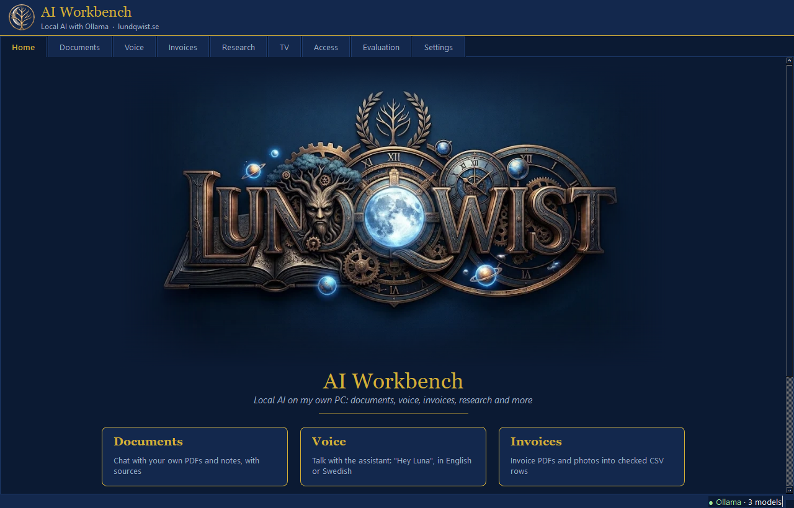
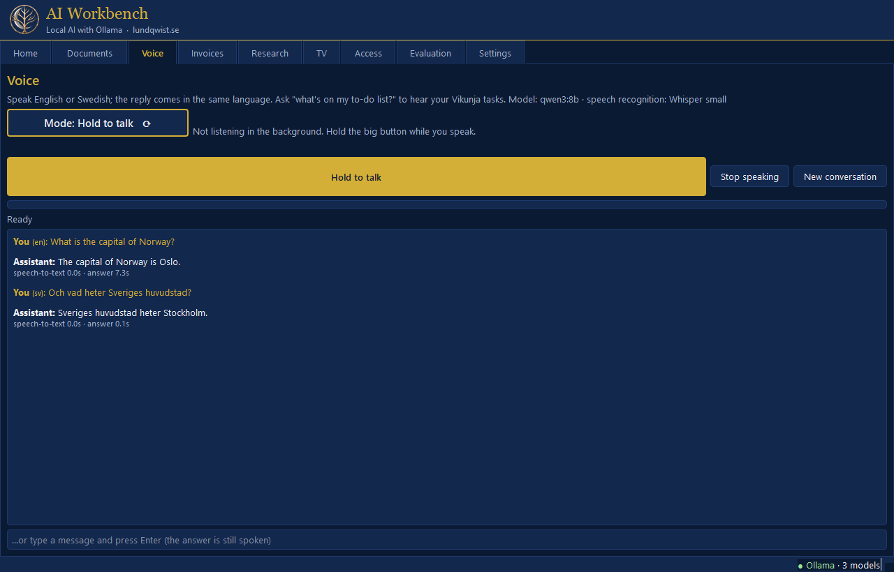
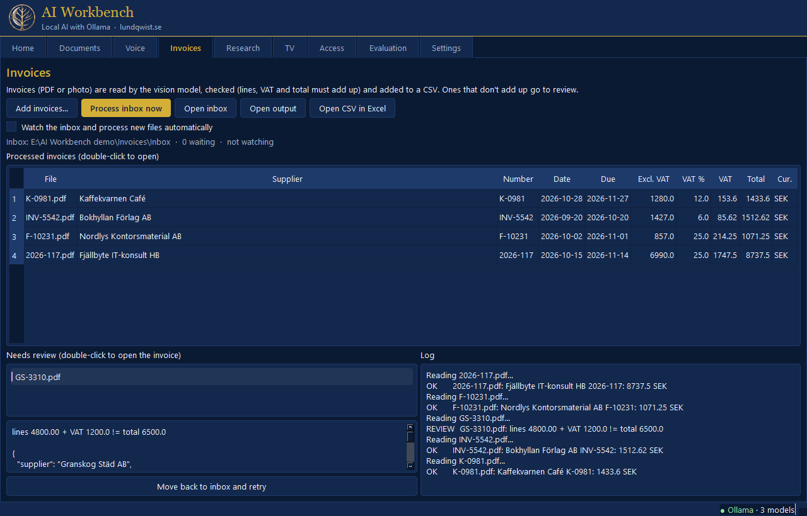
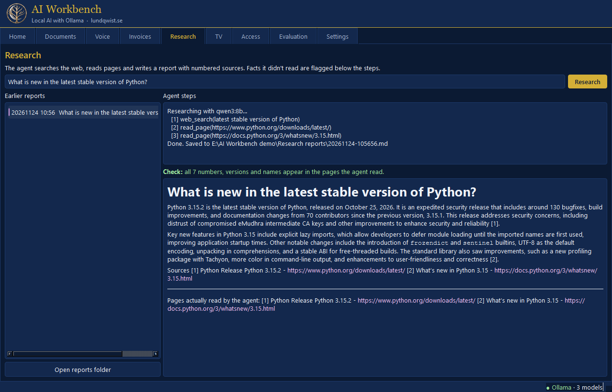
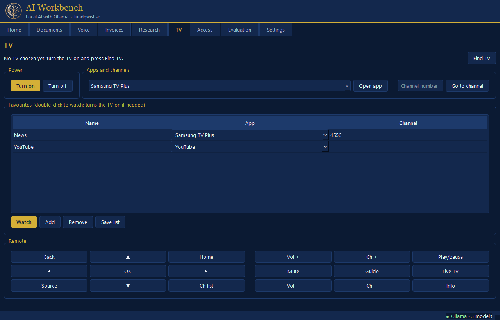
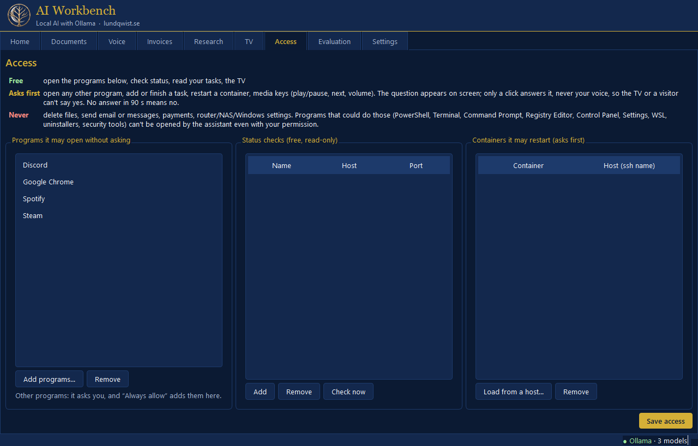
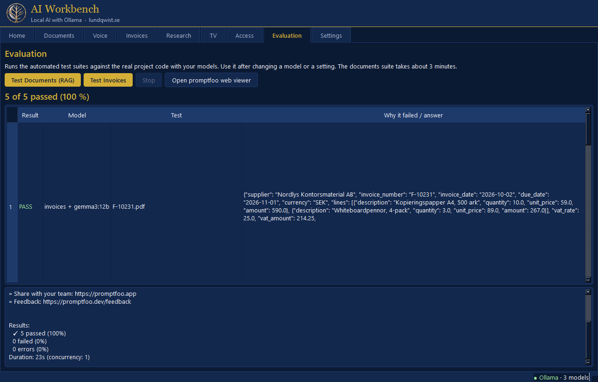
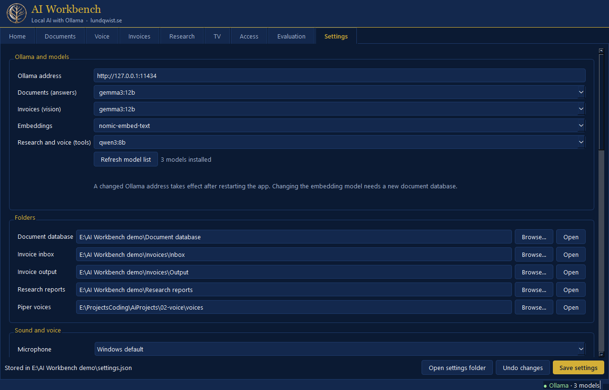

# AI Workbench

**Local AI on my own PC: documents, voice, invoices, research and more. No cloud, no API keys.**

AI Workbench is a Windows program (Python 3.12, PySide6) that runs five AI projects entirely on one PC with [Ollama](https://ollama.com), on an RTX 3080 Ti with 12 GB. It answers questions from my own documents with sources, turns invoice PDFs and photos into checked spreadsheet rows, writes cited research reports from the web, and has a voice assistant I wake with "Hey Luna", in English or Swedish. The assistant can run the TV, read my tasks and check my servers, and it asks on screen before doing anything more. Test suites with promptfoo keep the answers honest.



It's dressed in the navy and gold of [lundqwist.se](https://lundqwist.se), like my other Windows program, [StoryMaker](https://github.com/Lundqwist/StoryMaker): it opens on a front page with the Lundqwist emblem and a card for every tool.

## What it does

### Documents: answers from my own files, with sources

Add PDFs, Markdown and text files (buttons or drag-and-drop) and ask questions about them. Every answer cites the passages it came from, and when the answer isn't in the documents it says so instead of guessing. Built on ChromaDB with `nomic-embed-text` embeddings and `gemma3:12b` for the answers.


### Voice: a spoken assistant, in English or Swedish

Three ways to talk: say **"Hey Luna"** (an always-on wake word, all local), a conversation mode without the wake word, or hold the big button. Speech recognition is Whisper (faster-whisper), the voices are Piper, and the answer comes back in the language of the question. The assistant has tools: it can read and add my tasks, run the TV, play music on Spotify, open programs and check whether my servers are up.



### Invoices: PDFs and photos into checked rows

Drop invoices in, and a vision model reads supplier, number, dates, lines, VAT and total. The lines, VAT and total must add up before an invoice goes into the CSV; one that doesn't goes to review with the reason, so a misread number never slips through quietly.



### Research: a cited report from the web

An agent (`qwen3:8b` with tool calling) searches the web, reads the pages it chooses and writes a report with numbered sources. A grounding check then looks for numbers, versions and names in the report that weren't in any page it read, and flags them.



### TV: wake it, pick a channel, use a remote

Finds a Samsung TV on the network, turns it on with Wake-on-LAN, opens apps and favourite channels in one click, and has a full remote. The voice assistant uses the same code, so "turn on the news" works too.



### Access: what the assistant may do

The assistant's tools come in three levels. **Free:** open the programs on the list, check status, read tasks, the TV. **Asks first:** anything else, as a question on screen that only a click can answer (never a voice, so the TV or a visitor can't say yes), and no answer in 90 seconds is a no. **Never:** delete files, send messages, payments or system settings: no tool for them exists, and programs that could do them are refused even with permission.



### Evaluation: tests that keep it honest

[promptfoo](https://www.promptfoo.dev) test suites run against the real project code with my models: one for the document assistant (does it cite, does it refuse when the answer isn't there) and one for the invoices. The first run of the document suite found three bugs (80 % → 100 %).



### Settings

Models per task (filled from Ollama), folders, microphone and speakers, the speech model, voices with a voice library, and the integrations. At start it checks for updates to Ollama's models, voices, Python packages, the code and promptfoo, and installs them after closing.



## The five projects inside

Each one also runs on its own, with its own README.

| # | Project | What it does |
|---|---|---|
| 01 | [RAG document assistant](01-rag/) | Answers from your own PDFs and notes, with citations; says so when the answer isn't there |
| 02 | [AI voice agent](02-voice/) | Spoken conversation in English or Swedish, with tools |
| 03 | [Invoice automation](03-invoices/) | Invoice PDFs and photos → checked CSV rows; wrong totals go to review |
| 04 | [Research agent](04-research/) | Searches, reads pages and writes a cited report, plus a check for made-up facts |
| 05 | [AI evaluation platform](05-eval/) | promptfoo tests for 01 and 03; its first run found 3 bugs in 01 (80 % → 100 %) |
| app | [AI Workbench](app/) | The Windows program that uses all five (how it's built: [app/README.md](app/README.md)) |

## Built with

Python 3.12 · PySide6 (Qt 6) · Ollama (`gemma3:12b`, `qwen3:8b`, `nomic-embed-text`) · ChromaDB · faster-whisper · Piper · promptfoo · uv

Nothing personal is in the code: TV, programs, servers and integrations are filled in from the program's own settings, and tokens are read from environment variables, never stored. All test data in the repository is made up.

## Setup

```powershell
pip install --user uv
uv venv --python 3.12
.\.venv\Scripts\Activate.ps1
uv pip install -r requirements.txt
ollama pull gemma3:12b
ollama pull nomic-embed-text
ollama pull qwen3:8b
npm install -g promptfoo
```

Run the program with `.venv\Scripts\pythonw.exe app\main.py`, or make a Start menu shortcut with `app\install-shortcut.ps1`.

`app\selftest.py` drives every tab end to end with test data, and `app\make_screenshots.py` makes the screenshots above from the same made-up data.
