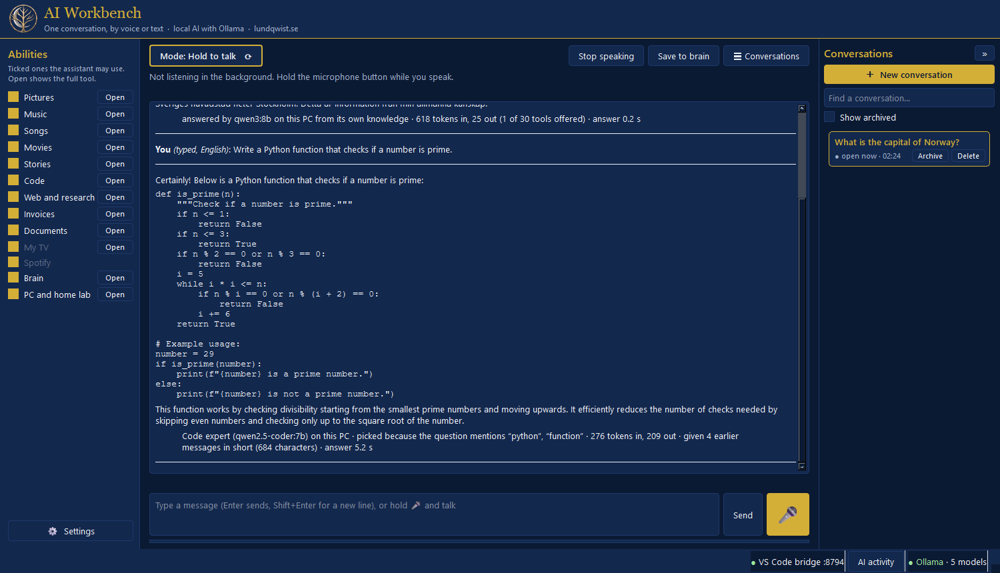
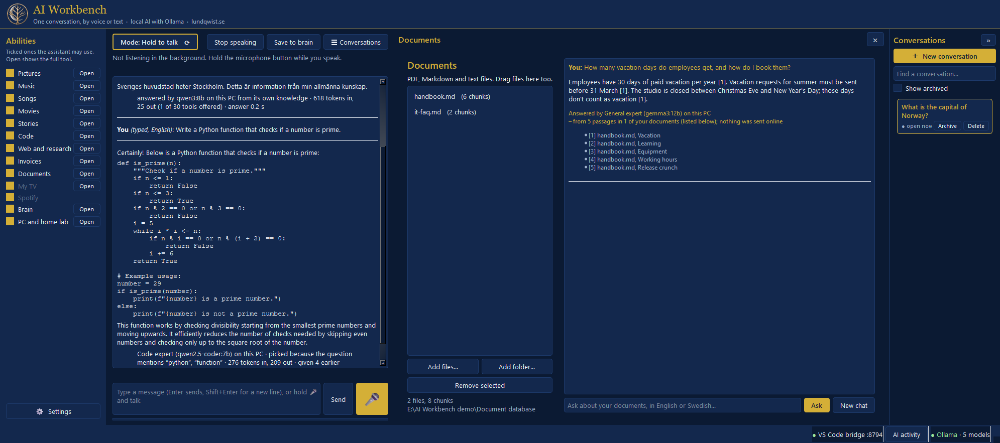
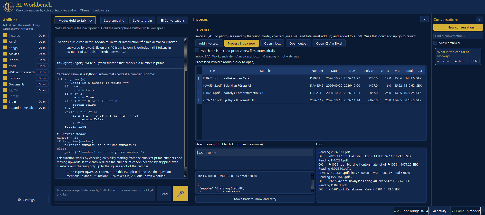
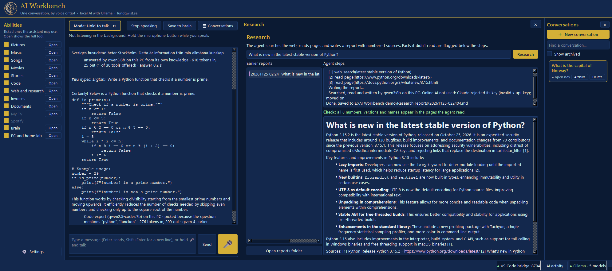
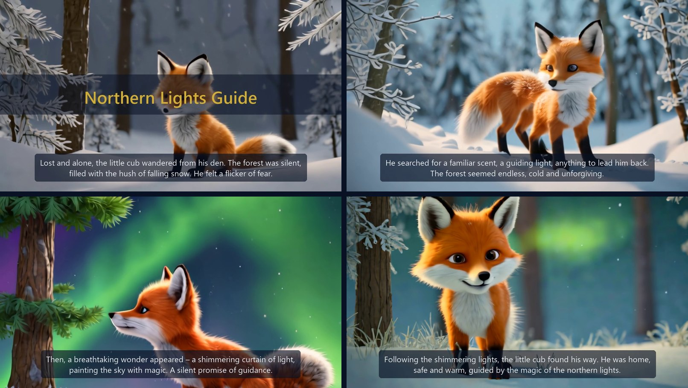
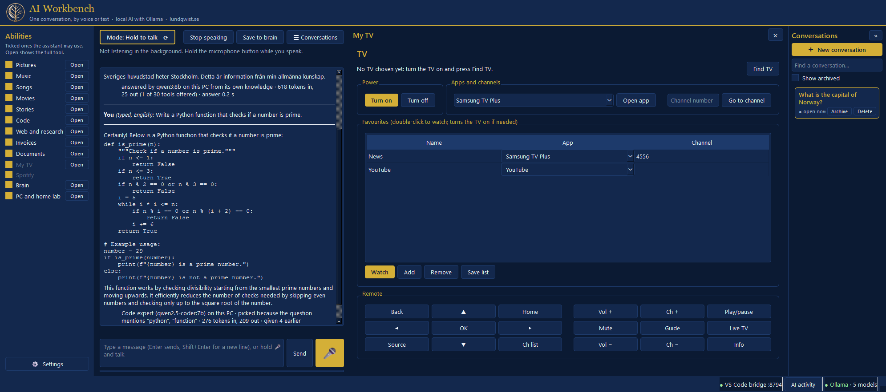
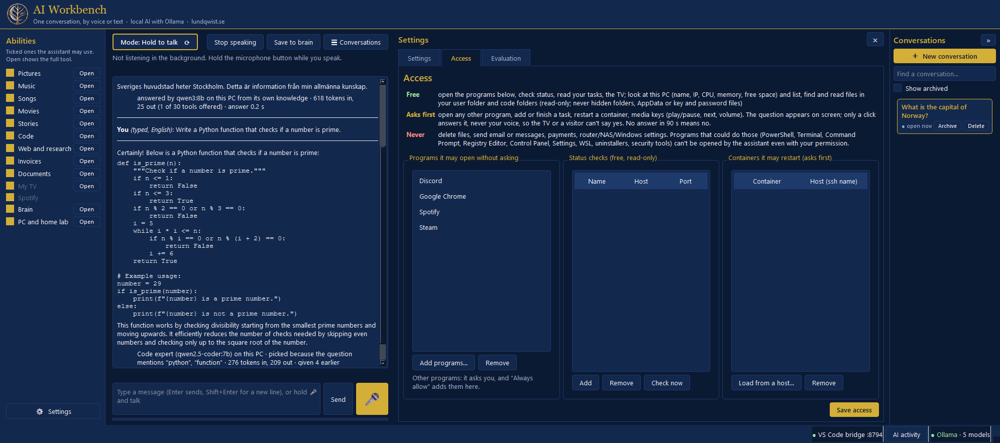
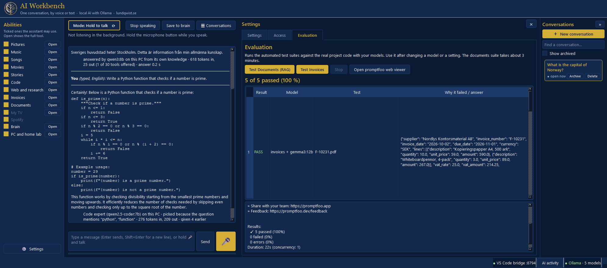
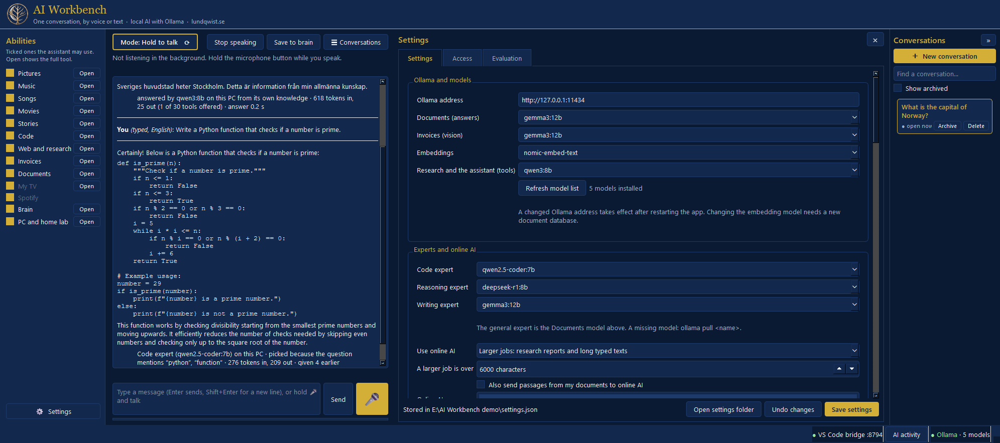

# AI Workbench

**Local AI on my own PC: documents, voice, invoices, research and more. No cloud, no API keys.**

AI Workbench is a Windows program (Python 3.12, PySide6) that runs five AI projects entirely on one PC with [Ollama](https://ollama.com), on an RTX 3080 Ti with 12 GB. It is built around **one conversation**: I type or talk (hold the microphone button, or say "Hey Luna"), in English or Swedish, and both continue the same conversation. Spoken questions get short spoken answers; typed ones get full answers with code on screen. On the left I tick what it may do: pictures, music, songs, movies, stories, code, web and research, invoices, my documents, my TV, Spotify, its long-term memory, and my PC and home lab. Each job goes to the local expert that fits it, and each answer says who did the work, what it used and how many tokens it took. A **VS Code extension** brings the same local experts into Visual Studio Code.



It's dressed in the navy and gold of [lundqwist.se](https://lundqwist.se), like my other Windows program, [StoryMaker](https://github.com/Lundqwist/StoryMaker).

## What it does

### One conversation, by voice or text

One input: type, or hold 🎤 and talk, or say **"Hey Luna"** (an always-on wake word, all local), or switch on a conversation mode without the wake word. Speech recognition is Whisper (faster-whisper), the voices are Piper, and the answer comes back in the language of the question. Typed and spoken messages are one conversation, so a follow-up works whichever way I asked before. Every conversation is saved by itself and listed on the right: click one to carry on where it stopped (the assistant remembers what was said in it), or archive or delete it.

**The right expert, and few tokens.** Before any model sees a message, a router picks only the tools it needs from the abilities that are ticked: "put CNN on the TV" is offered the four TV tools, not all 43 (about 2 300 characters of tool descriptions instead of 18 000). A question that needs no tool but is about code, maths or writing goes straight to that expert (`qwen2.5-coder:7b`, `deepseek-r1:8b`, `gemma3:12b`) with a short summary of the conversation instead of all of it. Larger typed jobs can go to an online AI while it has tokens; spoken questions and VS Code always stay on this PC.

### Visual Studio Code: coding help from my own PC

An extension adds an AI Workbench chat to VS Code. It sends my question with the selected code (or the open file), answers come from the local code expert with *Insert* and *Replace selection* buttons, and right-click gives *Explain*, *Find and fix problems* and *Write tests*. *Change this code…* shows the code expert's version as a diff before anything changes. It talks only to AI Workbench on this PC (a token-protected local bridge that refuses web pages), never to an internet AI. *Install in VS Code* in Settings builds and installs it.

### Documents: answers from my own files, with sources

Add PDFs, Markdown and text files (buttons or drag-and-drop) and ask questions about them, in their panel or straight in the conversation. Every answer cites the passages it came from, and when the answer isn't in the documents it says so instead of guessing. Built on ChromaDB with `nomic-embed-text` embeddings and `gemma3:12b` for the answers.



### Invoices: PDFs and photos into checked rows

Drop invoices in (or ask "read my invoices"), and a vision model reads supplier, number, dates, lines, VAT and total. The lines, VAT and total must add up before an invoice goes into the CSV; one that doesn't goes to review with the reason, so a misread number never slips through quietly.



### Research: a cited report from the web

An agent (`qwen3:8b` with tool calling) searches the web, reads the pages it chooses and writes a report with numbered sources. A grounding check then looks for numbers, versions and names in the report that weren't in any page it read, and flags them. In the conversation, quick facts come from a web search, and "research…" starts a full report in the background.



### Create: pictures, music, songs, stories and movies

Describe an idea in English or Swedish and the workbench makes it on this PC: pictures with SDXL-Turbo, short tunes with MusicGen, stories by the writing model, and **songs with singing**: the writing model writes rhyming lyrics with verses and a chorus (or I paste my own), and [ACE-Step 1.5](https://github.com/ACE-Step/ACE-Step-1.5) sings and plays it, as long as the lyrics need, about 30 seconds per minute of song. **Movies** are narrated short films: the writing model writes a screenplay, every scene is painted in the same style with the same characters, [LTX-Video](https://huggingface.co/Lightricks/LTX-Video) brings each painted scene to life as real video (characters move, water flows, the camera travels), a Piper voice narrates it, MusicGen scores it, and ffmpeg puts it together with crossfades, a title and subtitles. A 4-scene film of about 40 seconds takes 7–8 minutes. Every creation is saved with a record of which model made it and where. Asking in the conversation works too ("make a movie about a lighthouse keeper and a whale"), and it says so there when the film is ready.



### My TV: wake it, pick a channel, use a remote

Finds a Samsung TV on the network, turns it on with Wake-on-LAN, opens apps and favourite channels in one click, and has a full remote. The conversation uses the same code, so "turn on the news" works too.



### Access: what the assistant may do

The assistant's tools come in three levels. **Free:** open the programs on the list, check status, read tasks, the TV. **Asks first:** anything else, as a question on screen that only a click can answer (never a voice, so the TV or a visitor can't say yes), and no answer in 90 seconds is a no. **Never:** delete files, send messages, payments or system settings: no tool for them exists, and programs that could do them are refused even with permission.



### Evaluation: tests that keep it honest

[promptfoo](https://www.promptfoo.dev) test suites run against the real project code with my models: one for the document assistant (does it cite, does it refuse when the answer isn't there) and one for the invoices. The first run of the document suite found three bugs (80 % → 100 %).



### Settings

Models per task (filled from Ollama), experts and online AI, folders, microphone and speakers, the speech model, voices with a voice library, the integrations, the VS Code extension, and the Access and Evaluation tabs. At start it checks for updates to Ollama's models, voices, Python packages, the code and promptfoo, and installs them after closing.



## The five projects inside

Each one also runs on its own, with its own README.

| # | Project | What it does |
|---|---|---|
| 01 | [RAG document assistant](01-rag/) | Answers from your own PDFs and notes, with citations; says so when the answer isn't there |
| 02 | [AI voice agent](02-voice/) | Spoken conversation in English or Swedish, with tools (the core of the workbench's conversation) |
| 03 | [Invoice automation](03-invoices/) | Invoice PDFs and photos → checked CSV rows; wrong totals go to review |
| 04 | [Research agent](04-research/) | Searches, reads pages and writes a cited report, plus a check for made-up facts |
| 05 | [AI evaluation platform](05-eval/) | promptfoo tests for 01 and 03; its first run found 3 bugs in 01 (80 % → 100 %) |
| app | [AI Workbench](app/) | The Windows program that uses all five (how it's built: [app/README.md](app/README.md)) |
| vscode | [VS Code extension](vscode-extension/) | A chat and code commands in VS Code, answered by AI Workbench's local experts |

## Built with

Python 3.12 · PySide6 (Qt 6) · Ollama (`gemma3:12b`, `qwen3:8b`, `qwen2.5-coder:7b`, `deepseek-r1:8b`, `nomic-embed-text`) · ChromaDB · faster-whisper · Piper · PyTorch + diffusers (SDXL-Turbo, MusicGen, LTX-Video) · ACE-Step 1.5 · ffmpeg · promptfoo · uv · a VS Code extension in plain JavaScript

Nothing personal is in the code: TV, programs, servers and integrations are filled in from the program's own settings, and tokens are read from environment variables, never stored. All test data in the repository is made up.

## Setup

```powershell
pip install --user uv
uv venv --python 3.12
.\.venv\Scripts\Activate.ps1
uv pip install -r requirements.txt
ollama pull gemma3:12b
ollama pull nomic-embed-text
ollama pull qwen3:8b
npm install -g promptfoo
```

For Create (pictures, music, songs, stories, movies), install `requirements-create.txt` as described at the top of that file (PyTorch with CUDA), and for songs run `install-song-maker.ps1` once (ACE-Step in its own environment, about 13 GB), and for moving movie scenes `install-video-maker.ps1` (LTX-Video, about 25 GB; without it movies use still pictures with camera moves).

Run the program with `.venv\Scripts\pythonw.exe app\main.py`, or make a Start menu shortcut with `app\install-shortcut.ps1`. For VS Code, press *Install in VS Code* in Settings → VS Code.

`app\selftest.py` drives the conversation, every panel, the router and the VS Code bridge end to end with test data, and `app\make_screenshots.py` makes the screenshots above from the same made-up data.
